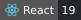
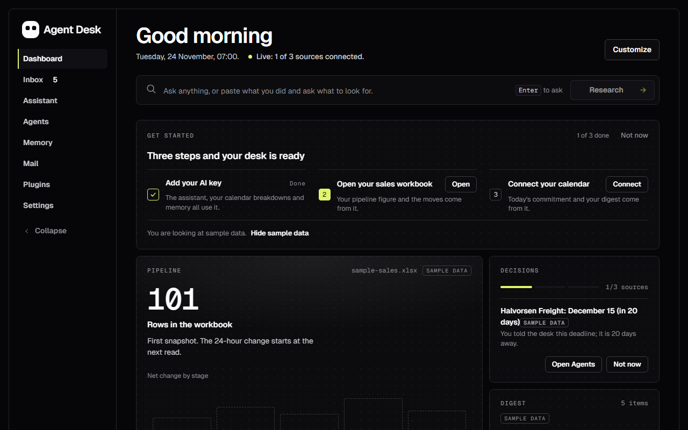
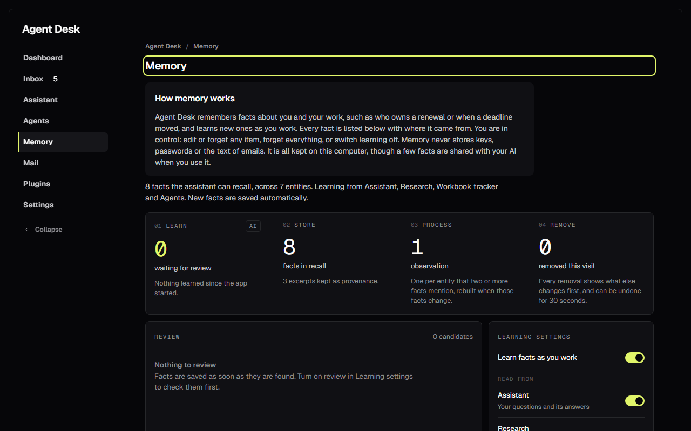
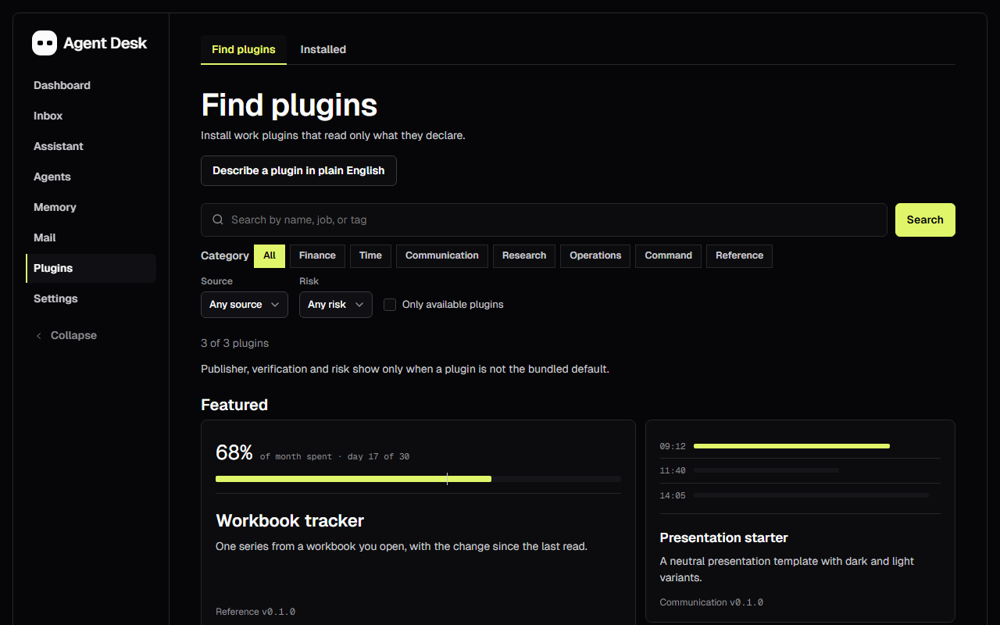
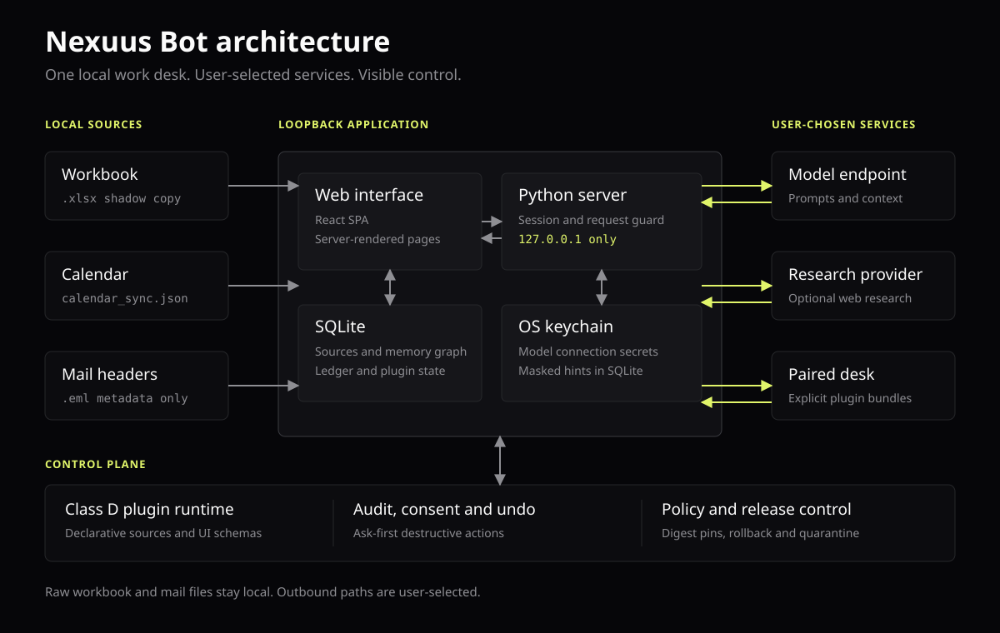

# Nexuus Bot

Nexuus Bot is a local-first web workspace for your workbook, calendar, exported mail, memory, agents, and plugins. It shows what changed, answers work questions, records facts with sources, and keeps plugin actions behind visible controls.

[](https://github.com/kanitmann01/agent-desk/actions/workflows/enterprise.yml)
[](pyproject.toml)
[](frontend/package.json)
[](docs/PRD.md)
[](LICENSE)

**Status:** Single-user evaluation software. The core uses a proprietary draft license. No signed installer or released distribution exists.

<p align="center">
  
</p>

## What it does

- Build a morning brief from workbook changes, calendar commitments, decisions, and desk health.
- Connect named OpenAI-compatible endpoints and route jobs to different models.
- Ask research questions and save repeatable skills.
- Keep a local memory graph with sources, review controls, optional encryption, and a graph view.
- Run worksheet-brief and presentation agents with receipts and source records.
- Browse, validate, install, update, and roll back Class D plugins through one consent path.

## Quick start

The app requires Python 3.10 or later. Use Python 3.12 for the full development gate. The frontend development tools need Node 20.19 or newer on the Node 20 line, or Node 22.12 or newer; that floor is Vite 7's own requirement, recorded in `frontend/package-lock.json`. Node 18, Node 19, Node 20 versions before 20.19, every Node 21 version, and Node 22 versions before 22.12 do not work with the frontend tools.

```bash
git clone https://github.com/kanitmann01/agent-desk.git
cd agent-desk
python -m pip install -e ".[dev]"
```

The repository and clone folder (`kanitmann01/agent-desk`), the launcher filenames (`tools/agent-desk.cmd`, `tools/agent-desk.command`) and the `.agent-desk` data folder keep their existing names: they are compatibility contracts that keep existing desks and scripts working, not the product's name. The product on screen is Nexuus Bot.

On Windows, double-click `tools/agent-desk.cmd`.

On macOS, make the launchers executable. Then double-click `tools/agent-desk.command`.

```bash
chmod +x tools/*.command
```

To start from a terminal, run:

```bash
python -m agentdesk.server
```

Add `--no-browser` to skip the browser open. The server binds to `127.0.0.1` only. The one-time start link creates your local session.

The Settings page is the normal configuration path. Optional text configuration lives at `%USERPROFILE%\.agent-desk\config.env` on Windows or `~/.agent-desk/config.env` on macOS.

- **Mail folder and Outlook alerts**: mail is off by default. Turn the digest on in Settings and choose the folder your `.eml` exports land in; the desk reads the file headers only and never keeps a body. The optional "Fetch Outlook alerts" toggle, in the Workbook, calendar and mail card, reads the local OS notification store while the app is open, writes the sender and subject of each Outlook alert as header-only `.eml` files into that folder, and drops the preview. Turning the alerts on also turns on the mail digest, because the alert files land in the folder it reads. It is a live alert signal, not a mailbox mirror: saved `.eml` files are the history source, Windows keeps only a short alert history, and the macOS reader needs Full Disk Access. The Workbook, calendar and mail card shows the collector, the last run, the coverage window and any honest cause.

## Product tour

### Memory with provenance



Memory keeps sources beside facts. You can edit, delete, merge, sweep, and encrypt the local bank. Newer facts can replace older values. Recall skips superseded values unless you keep both.

### Marketplace and plugin control



The marketplace combines the bundled, organization, and peer catalogs. The install path validates catalog pins and runs the shared validator before it writes plugin files.

| Plugin | Current behavior |
|---|---|
| `excel-report` | Working Workbook tracker with configurable metrics and charts. |
| `competitor-watch` | Cataloged. It cannot run because the production plugin runner has no HTTP transport. |
| `presentation-starter` | Provides presentation templates and tools. It does not add a dashboard card. |

Updates show new permission scopes before they apply. Rollback restores the previous release. Uninstall keeps plugin data. Purge requires the typed `delete-data:<id>` confirmation.

## How it works



- Python serves the app on loopback with session, Host, and Origin guards.
- The committed React bundle serves the dashboard and marketplace. Other pages use server rendering.
- SQLite stores source snapshots, memory, audit events, plugin state, and run history.
- Where a usable OS keychain is available, model keys are stored in the OS keychain. Where there is none, no key is stored: a save is refused, and keys still reach the app as plain text through the environment or the optional `config.env` file, or through the legacy settings rows from earlier builds. SQLite keeps masked hints only.
- OpenAI-compatible connections use the endpoint and model you choose.
- The optional engine sidecar calls only four desk-owned tools. The fixed loop remains the default.

## Privacy and control

- Raw workbook and mail files stay on this machine.
- Mail reads headers only. It does not parse message bodies. Mail is off by default.
- Typed questions and selected context go to the model endpoint you configure.
- Optional presentation research sends topics and section titles to the research provider you configure.
- Peer discovery announces desk identity on the local network. Sharing transfers only plugin bundles you select.
- Class D plugins use manifests and declarative UI schemas. They do not receive shell access or plugin HTML.
- The audit ledger records actions. Consent, undo, digest pins, rollback, and quarantine protect plugin changes.
- Memory encryption is optional. It is off by default.

## Development

Run the backend test suite from the repository root:

```bash
python -m pytest tests -q --no-header
python tools/demo_readiness.py
python tools/ci_local.py
```

Run the frontend test suite from `frontend/`:

```bash
npm ci
npm run build
npm run check
npm test
```

The full gate runs Python tests, frontend typecheck, Vitest, the license gate, registry CI, and naming guards.

The Outlook alert feeder lives in `src/nexuusbot/feeder/`: one platform-agnostic core over the existing header-only `Message` type, a Windows toast reader and a macOS Notification Center reader behind one collector protocol, an atomic `.eml` writer, and one status record. It runs inside the mail watcher only while the app is open and creates no OS task or service.

The layout audit plans the `fresh`, `data`, `plugins`, `full`, `long-values`, `busy`, and `legacy-dashboard` conditions. The `busy` condition uses synthetic capability cache fixtures and injected UNKNOWN gate runners. It never retests machine capabilities, reaches an external probe endpoint, installs a package, lists processes, or writes a OneDrive probe.

The layout audit holds every non-GET request by default. Repeat `--continue-request-path PATH` to continue only non-GET requests whose URL path exactly matches a named path and whose origin is the isolated desk's own origin. GET behavior is unchanged, and every other non-GET remains held. Values under `/capabilities/`, including capability retest paths, are refused after percent-decoding with exit 2 before any run folder, child, mock, or desk starts.

The slow run is this option's only current use. It lets the `full` condition's Research request reach the loopback mock delayed by four seconds. The `fresh` and `plugins` conditions do not start or pin that mock, so this command does not claim a delayed model answer for them:

```bash
uv run --no-project --with playwright --with keyring --with cryptography \
  python tools/layout_audit.py --pending-audit \
  --conditions fresh,plugins,full --widths 1280 --themes unkey \
  --no-stress --fail-on none --jobs 3 \
  --continue-request-path /research --mock-delay-ms 4000 --out <dir>
```

The face walkthrough photographs the agent's face in every mood and on every surface. It boots the same isolated desk as the layout audit and starts the dev-only review sheet from `frontend/`:

```bash
uv run --no-project --with playwright --with keyring --with cryptography python tools/face_walkthrough.py
```

`--sheet-only` photographs the review sheet alone and boots no desk. Exit codes: 0 when every planned photograph was taken and every check passed (surfaces with no face are listed, not failed), 1 when a check failed or a planned photograph is missing, and 2 when the desk, the browser or the dev server did not start.

## Documentation and IT review

| Document | Purpose |
|---|---|
| [Product requirements](docs/PRD.md) | Personas, surfaces, action inventory, and phasing. |
| [Design language](docs/design-language.md) | Current themes, tokens, layout, and interaction rules. |
| [Known limitations](docs/known-limitations.md) | Verified gaps in the current build. |
| [Marketplace operator guide](docs/ops/marketplace-operator.md) | Installs, publishing, policy import, audit export, and kill switch. |
| [Distribution guide](docs/ops/distribution.md) | Nuitka build, AppLocker template, and update channel. |
| [Licensing](docs/licensing.md) | Core, plugin SDK, and third-party license boundaries. |
| [Demo script](DEMO.md) | One manager's morning with Nexuus Bot. |
| [Evidence](docs/evidence/) | Dated screenshots, gate transcripts, and walkthrough records. |

The running app also exposes `/what-this-touches`, `/audit/export.csv`, and `/marketplace/trust` for local IT review.

## License and current status

- The core uses a proprietary draft license that counsel has not reviewed.
- The plugin SDK uses Apache-2.0.
- Nexuus Bot has no signed release, SSO, RBAC, multi-user support, fleet management, or MCP server.
- No working web-page monitor ships.
- Peer sharing works between desks on one machine. LAN desks can be discovered but not connected to.
- The app has no autostart, Windows service, scheduled task, or tray helper.
