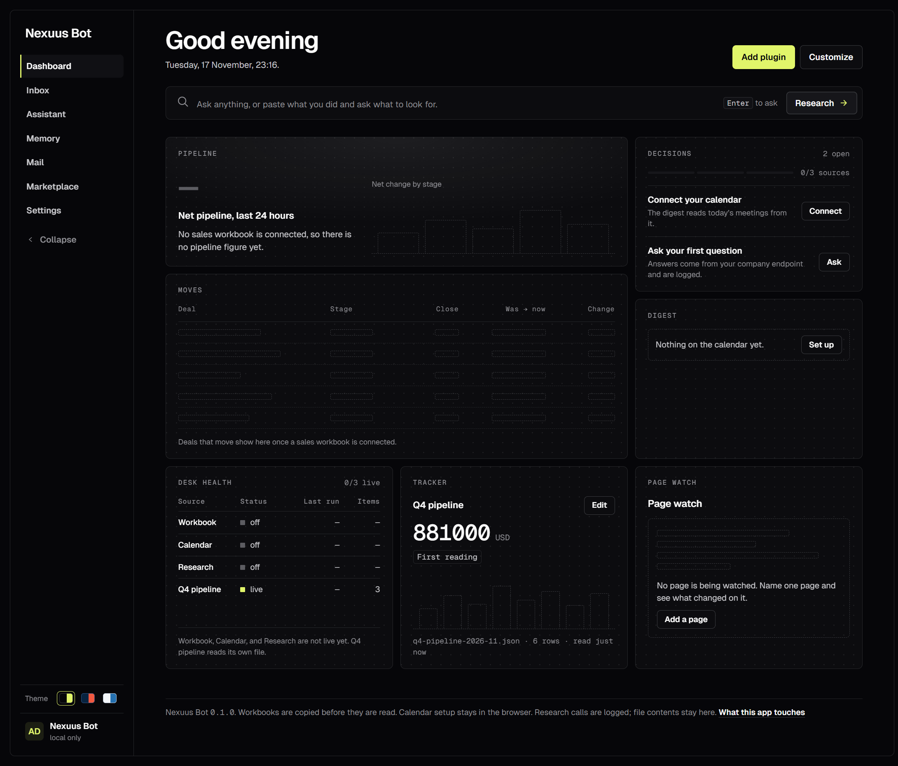
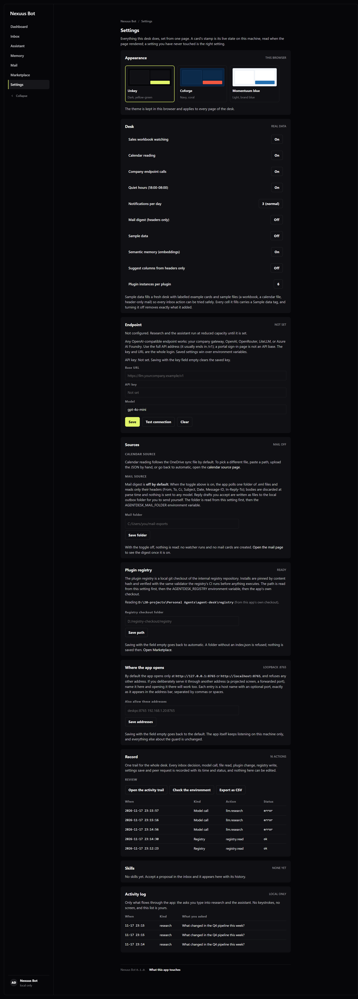
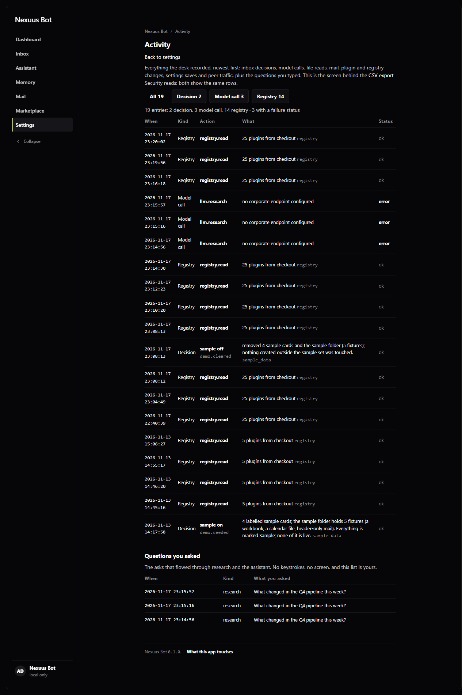
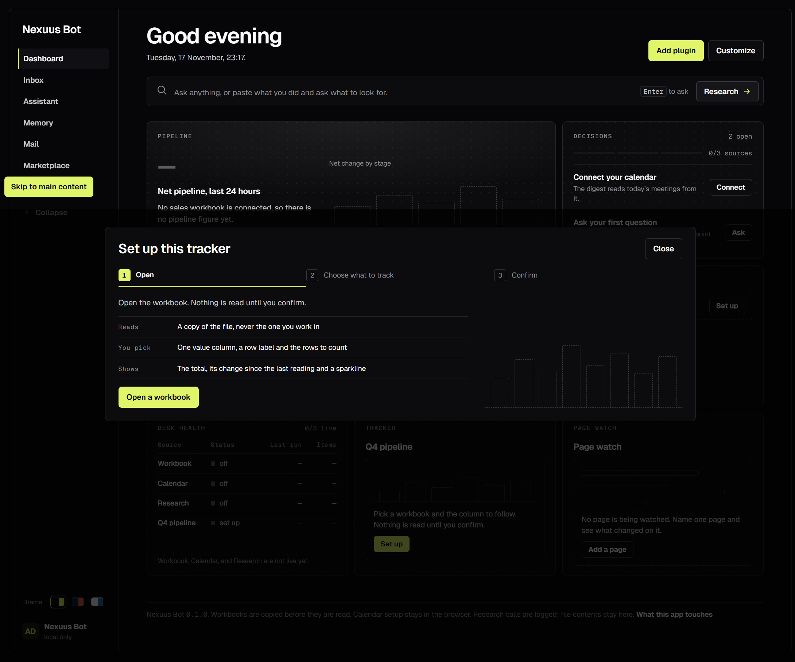

# EVP walkthrough: real data, one trail, one settings home

Prepared 2026-11-17 for the 2026-11-18 demo. Built from
[spec 007](../../specs/007-real-data-audit-and-settings.md) and
[tickets T01-T06](../tickets/2026-11-17/). Verified in a real browser against
the served app, not a headless test harness.

## What the demo proves

| Claim | Where it is visible |
| --- | --- |
| The tracker reads a real JSON export, not sample data | Dashboard TRACKER card: **Q4 pipeline, 881,000 USD**, footer `q4-pipeline-2026-11.json · 6 rows · read just now`, no SAMPLE DATA stamp |
| Browse accepts .xlsx, .csv and .json | Tracker Setup step 1: "Open a workbook" opens the native picker filtered to those four suffixes |
| The user picks the rows that count | Step 2 grid: click the Amount header (Value column), the Deal header (Row label), tick six rows |
| One model call checks the choice | Step 2 **Continue** posts `/evaluate`; with no endpoint the sheet says **CHECK SKIPPED** and keeps the user's choice |
| Accept or decline a suggestion | If the reply carries a recommendation the sheet shows **Use this instead** / **Keep mine**; otherwise it goes straight to naming |
| One audit trail | Settings > Activity: every audit row newest first, kind filter, CSV export, plus the questions typed |
| One settings home | Settings is one card stack with live state stamps; Activity and Capabilities are one click away |
| Rail is decluttered | Seven links: Dashboard, Inbox, Assistant, Memory, Mail, Marketplace, Settings |

## The 8-minute script

Preconditions: launcher running, the demo data dir open, **Settings > Desk >
Sample data = Off**. The desk already has the Workbook tracker plugin installed
and the Q4 tracker confirmed. If you re-stage the file, the tracker returns to
"Set up" until you confirm again (the UI does not resume a staged file; see
Known limits).

1. **Open on the dashboard.** Point at the TRACKER card: real file name, six rows,
   "read just now", 881,000 USD. Point at the absence of the SAMPLE DATA stamp.
   PIPELINE and MOVES explain they need a workbook because no sales workbook is
   connected; that is honest, not broken.
2. **Settings.** One card stack: Appearance (THIS BROWSER), Desk (REAL DATA),
   Endpoint (NOT SET), Sources (MAIL OFF), Plugin registry (READY), Where the app
   opens (LOOPBACK :8765), Record (N ACTIONS), Skills, Activity log. The stamp on
   each card is live state, not decoration.
3. **Settings > Record > Open the activity trail.** Show the filter chips and the
   rows: decisions, model calls, file reads, plugin and registry changes, settings
   saves. Export as CSV is the same rows Security reads.
4. **Marketplace (optional, 60 s).** Installed tab shows Workbook tracker.
   Do not install another bundled plugin before the demo: 24 of the 25 bundled
   pins are stale (issue #115) and would answer `install:digest-mismatch`.
5. **Tracker setup.** Dashboard TRACKER > **Edit** (or **Set up** after a reset).
   Step 1 explains what is read; **Open a workbook** opens the native picker.
   This step cannot be automated by the harness; click it yourself.
6. **Choose what to track.** Set **Header click sets** to Value column, click
   Amount; set to Row label, click Deal. Tick rows 0,1,2,3,4 and 7 (the six open
   deals). Click **Continue**.
7. **The model check.** With no corporate endpoint: **CHECK SKIPPED**, "Model
   check skipped: no corporate endpoint configured. Your choice is used as
   chosen." This is the honest fallback, not a fake verdict. With an endpoint,
   either the sheet says LOOKS RIGHT and continues, or it shows a recommendation
   with **Use this instead** / **Keep mine**.
8. **Confirm.** Name it (Q4 pipeline), unit USD, Confirm. The card returns with
   the sum of the chosen rows and a fresh reading time. Settings > Activity now
   has the new rows.

## Evidence

| Check | Result | Evidence |
| --- | --- | --- |
| JSON file previews as a table | Pass | 8 deals, 6 headers, staged through the same API the sheet uses |
| Evaluation call never blocks confirmation | Pass | `verdict: unchecked`, message names the missing endpoint; confirm returned 200 |
| Tracker card shows file, rows, freshness | Pass | `q4-pipeline-2026-11.json · 6 rows · read just now`; sample stamp absent |
| Sample data off removes SAMPLE stamps | Pass | Dashboard DIGEST and PAGE WATCH show empty states, not sample rows |
| Rail is seven links on every page | Pass | Server pages and SPA both render Dashboard/Inbox/Assistant/Memory/Mail/Marketplace/Settings |
| `/activity` still answers | Pass | 302 to `/settings/activity` |
| Hidden routes do not dead-end | Pass | `/peers` renders without a rail entry; `/capabilities` renders with "Back to settings" |
| Audit trail shows non-decision rows | Pass | `llm.research`, registry and settings rows visible; CSV carries the same rows |
| Kind filter | Pass | `?kind=Model%20call` shows only model calls, hides the questions table |
| No console errors on the demo pages | Pass | Dashboard, Settings, Activity, Marketplace: 0 errors; one VERBOSE DOM warning about the endpoint password field (cosmetic, see limits) |
| Unit tests for the changed surfaces | Pass | `test_activity_page.py` 10 passed; `test_server_shell/dashboard` 45 passed together |
| Full suite | **Not green** | 2148 passed, 14 failed, 1 skipped; the one failure outside issue #115 (endpoint hint copy) is fixed and its files pass 58/58. The remaining 13 are the pre-existing bundled-registry pin drift tracked in issue #115, explicitly out of scope for this demo |

## Known limits (say these before the EVP asks)

- **The model check is skipped on this machine.** No corporate endpoint is
  configured. The sheet says so in plain words. The accept/decline branch exists
  and is unit-tested, but a live suggestion cannot be shown without an endpoint.
- **Bundled plugin pins are stale for 24 of 25 plugins.** Installing anything
  other than Workbook tracker will refuse with a digest mismatch. That is issue
  #115, deliberately not fixed on demo eve.
- **The setup sheet does not resume a staged file.** Editing an existing tracker
  starts again at "Open a workbook". Annoying, not blocking; the file is one click
  away in the native dialog.
- **The native file picker cannot be driven by the browser harness.** The harness
  staged the same file through the same API for evidence; the click itself is
  manual.
- **Capabilities is still its own URL.** It is linked from Settings and has a
  "Back to settings" link, but it is not physically a section of the Settings
  document. Moving it would have rewritten a dozen capability tests before the
  demo; it is the first follow-up after.
- **One cosmetic console warning** on Settings: the endpoint API key input is not
  wrapped in a `<form>`. Chrome logs it as VERBOSE; it does not affect saving.
- **Sample data is off, not deleted.** Turning it on in Settings > Desk restores
  the sample desk for a later demo.

## Reset between rehearsals

1. Settings > Desk > Sample data: Off.
2. If the tracker was re-staged, confirm it again (step 6-8 above). The API path
   used for the screenshots was stage -> evaluate -> confirm on instance `main`.
3. Clear the browser tab and reopen the start link from the launcher window; the
   session cookie is per launch.

## Not in this demo

- Issue #115 (registry pins, red enterprise workflow).
- Nuitka/SBOM/release packaging (issue #115 and known limitations).
- Multi-user, RBAC, trust store, publisher verification.
