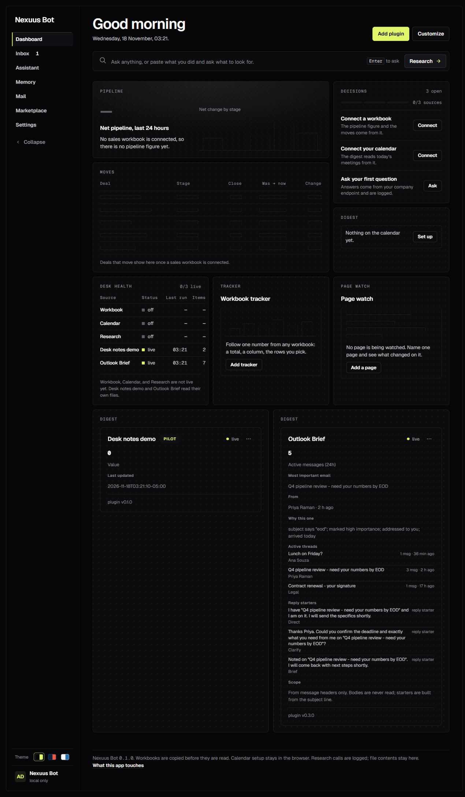
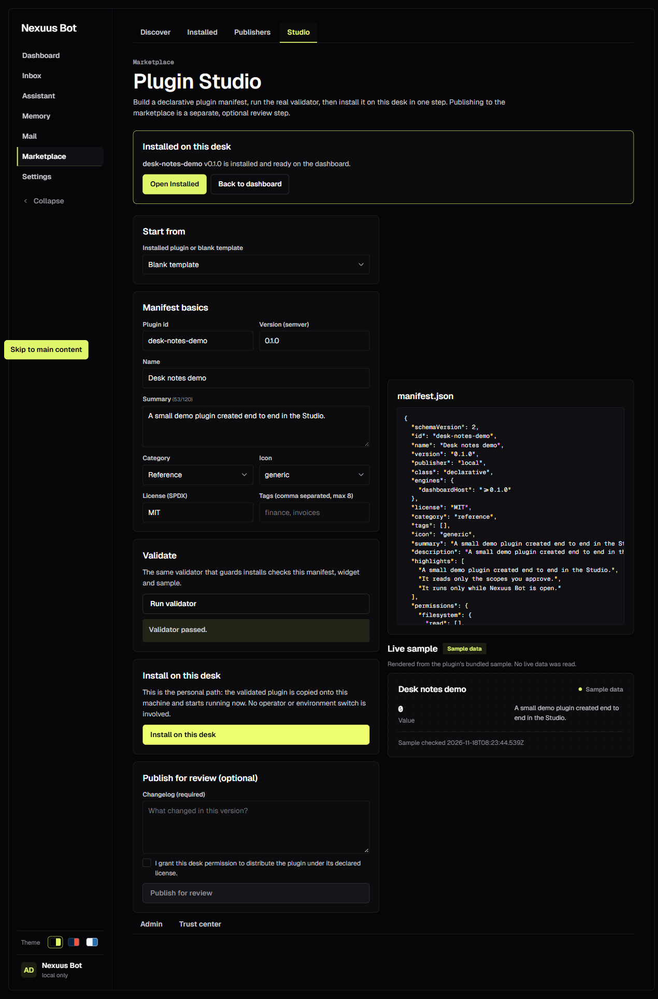
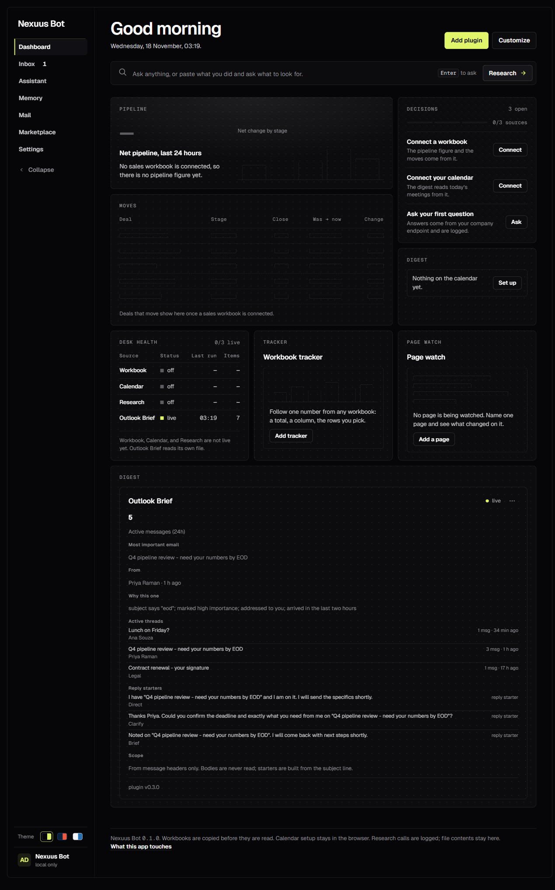
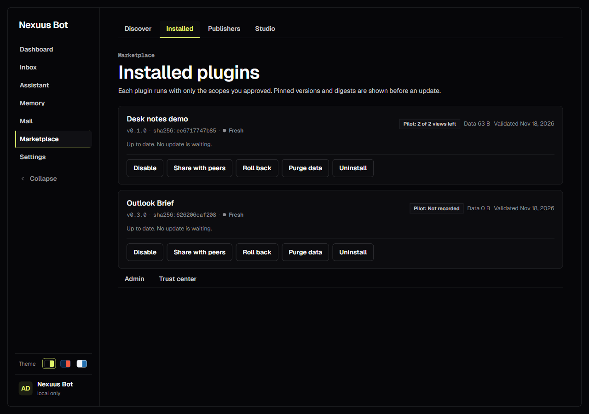

# Plugin walkthrough: install truth, Studio creation, Outlook Brief

Prepared 2026-11-18 for the EVP demo. Built from
[spec 008](../../specs/008-plugin-truth-and-outlook-brief.md) and tickets
[T01-T05](../tickets/2026-11-18/). Verified in a real browser against the served
app on an isolated demo desk, not only in tests.

## What the demo proves

| Claim | Where it is visible |
| --- | --- |
| Marketplace installs work again | All 25 local registry pins match their plugin trees; registry, catalog and walkthrough tests pass 36/36; a live catalog install returned 200 on the demo desk |
| Studio creation ends on the desk | Plugin Studio: fill id, name and summary, run the real validator, click **Install on this desk**, then open the new card on the dashboard |
| The created card is live, not amber | Dashboard shows **Desk notes demo**, value `0`, `Last updated 2026-11-18T03:21:10-05:00`, plugin v0.1.0; Installed shows **Fresh**, data 63 B |
| Outlook works without a connector | Plugin card reads the exported `.eml` folder and shows **5** active messages, top email, why it is top, active threads, three reply starters and the scope line |
| The Outlook card is the plugin, not the home page | Digest, most important email, reply starters and the scope line are seven bindings rendered inside the Outlook Brief card; the homepage is unchanged |
| Bodies stay unread | Card footer: `From message headers only. Bodies are never read; starters are built from the subject line.` |
| The no-connector path is repeatable | `demo/outlook-inbox` ships six header-only `.eml` files; `tools/export-outlook.ps1` exports the same shape from a real Outlook profile |

## The 8-minute script

Preconditions: the demo desk is running at `127.0.0.1:8878`, Settings > Desk >
Sample data is **Off**, Settings > Mail source points at
`demo/outlook-inbox`, and the Outlook Brief plugin is installed. The exact
server URL is printed at startup and includes the one-time auth token.

1. **Open the dashboard.** Point at the **Outlook Brief** card. Read it top to
   bottom: `5` active messages, most important email **Q4 pipeline review -
   need your numbers by EOD**, from **Priya Raman · 2 h ago**, why it is top
   (`subject says "eod"; marked high importance; addressed to you; arrived
   today`), three active threads, three reply starters labelled
   Direct, Clarify and Brief, then the scope line. Emphasise that every value
   came from message headers; no body, no Graph call, no connector.
2. **Point at the other new card.** **Desk notes demo** is the plugin created
   in Studio earlier. It shows value `0` and a real last-updated timestamp, not
   `reading the data source` and not an amber failure.
3. **Marketplace > Installed.** Two plugins: Desk notes demo v0.1.0 (**Fresh**, data
   63 B) and Outlook Brief v0.3.0 (**Fresh**). The digest, pinned version and
   scopes are visible before any update.
4. **Marketplace > Studio.** Fill **Plugin id** `desk-notes-demo`, **Name**
   `Desk notes demo`, **Summary** `A small demo plugin created end to end in the
   Studio.` Click **Run validator**. The status reads **Validator passed.**
5. **Click Install on this desk.** The panel reads `desk-notes-demo v0.1.0 is
   installed and ready on the dashboard.` Open **Back to dashboard** and point
   at the card again. This path needs no admin switch; publication to the
   marketplace is the separate, optional review step.
6. **Show the source, not a mock.** Open `demo/outlook-inbox` in Explorer. Six
   `.eml` files, including a thread with `Re:` replies and one high-importance
   message. Explain that `tools/export-outlook.ps1` writes the same files from
   an Outlook profile using header properties only.
7. **Close on honesty.** The card never claims to send, never reads bodies and
   never invents a number when the folder is empty or unparsable. Both states
   have their own copy.

## Evidence

| Check | Result | Evidence |
| --- | --- | --- |
| Registry pins match every local plugin tree | Pass | `python scripts/sync_registry.py` synced 25; catalog rebuilt; registry/catalog tests 36 passed |
| A live catalog install completes | Pass | `POST /api/marketplace/install` `{"id":"research-brief"}` returned 200 `{"version":"0.2.0","status":"installed"}`; `/api/marketplace/installed` listed it; `POST /api/marketplace/uninstall` returned 200 `{"state":"uninstalled","data_preserved":true}` |
| Studio install creates a usable card | Pass | `tests/test_studio_install.py` 2 passed; browser validator passed, install returned 200, dashboard card rendered 0 with timestamp |
| A restarted runtime rebinds enabled plugins | Pass | `tests/test_plugins_runtime.py` 10 passed; card payload is non-empty after a fresh `PluginRuntime` with the same dirs |
| Outlook Brief reads headers, ranks and suggests | Pass | `tests/test_mail_brief.py` + `tests/test_plugins_execute.py` + `tests/test_mail_watcher.py`: 59 passed |
| Plugin family contracts agree | Pass | `tests/test_plugins_communication.py` + `tests/test_marketplace_policy.py`: 43 passed |
| Frontend type and unit checks | Pass | `npx tsc --noEmit` clean; `npx vitest run` 22 files / 262 tests passed |
| Full Python suite | Pass | `python -m pytest -q`: 2224 passed, 1 skipped in 404.96s |
| Browser card content | Pass | Playwright read the live card: 5 messages, top subject, sender, why line, 3 thread rows, 3 reply starters, scope, plugin v0.3.0 |
| Browser console | Pass | Studio, dashboard and Installed pages: 0 errors, 0 warnings |
| No connector required | Pass | Only `.eml` files on disk; demo inbox has 6 messages; no Graph, IMAP, COM or network call in the plugin |

## Known limits

- Outlook export is a Windows helper, not a connector. It needs Outlook with a
  configured profile. This machine has `OUTLOOK.EXE` but no mail profile, which
  is exactly why the demo uses the exported `.eml` folder.
- The product reads `.eml` headers only. Bodies, attachments and calendar
  replies are out of scope for this demo.
- Reply starters are suggestions built from the subject line. They are not
  drafted messages and nothing is sent.
- Marketplace publication still ends at pending review and needs the admin
  switch. Studio's **Install on this desk** is the personal path and does not
  sign or distribute anything.
- The demo desk is isolated at
  `C:\Users\mannk\AppData\Local\Temp\agentdesk-plugins-2026-11-18`; the
  normal desk is untouched.

## Reset

1. Stop the demo server.
2. Delete `C:\Users\mannk\AppData\Local\Temp\agentdesk-plugins-2026-11-18`.
3. Re-run the demo staging script or reinstall Outlook Brief from Marketplace.
4. Set Settings > Mail source to `demo/outlook-inbox`, enable mail, and restart.
5. Recreate the Studio plugin if the card is needed for the walkthrough.
