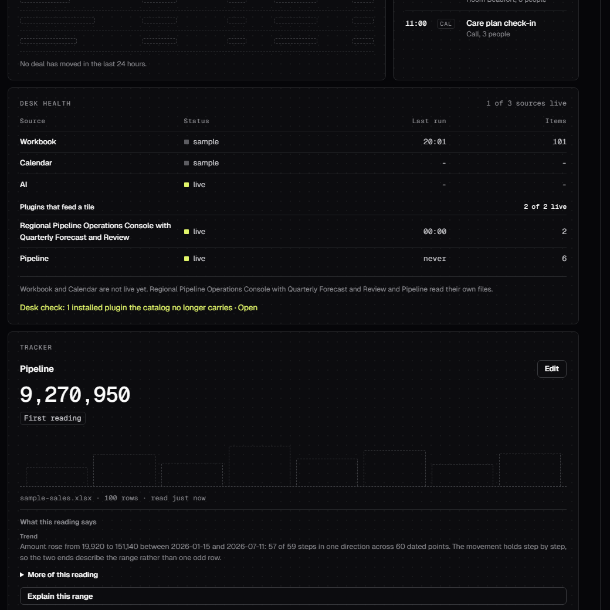
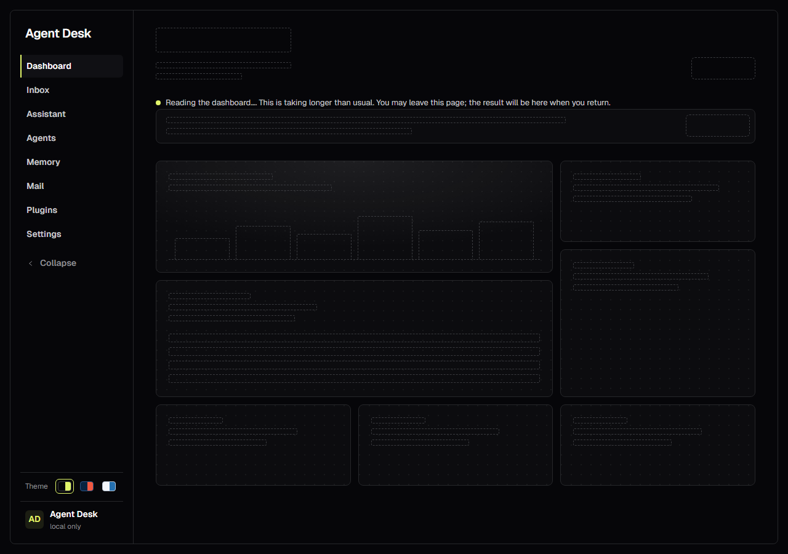
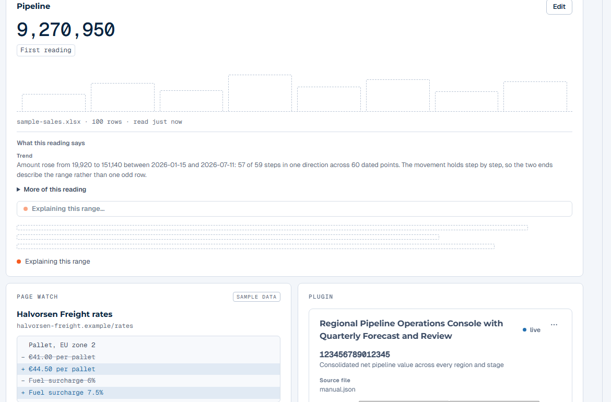
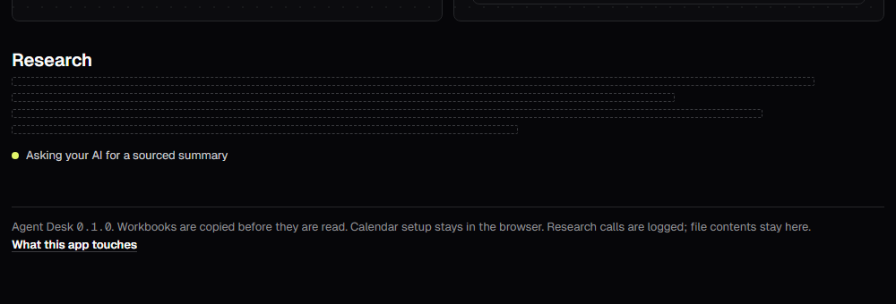
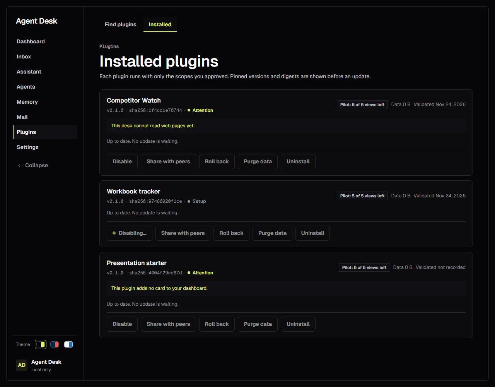
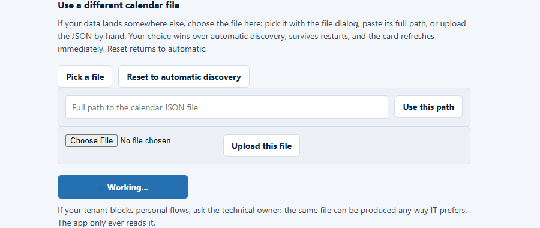

# Evidence: one home screen and feedback on every wait (spec 027), 2026-11-24

All readings below are from the same final tree as the text-fit evidence,
`261d925` on `merge/027-feedback`, with the same instrument and the same
kind of isolated desk. The wave starts at `f31582a`. This branch,
`docs/026-027-evidence`, is cut from `261d925` and changes documentation
and screenshots only. Spec 026's readings are in
`docs/evidence/2026-11-24-text-fit/EVIDENCE.md`.

## What was built

### One home screen

- One tracker face. `restatesTile` in
  `frontend/src/dashboard/TrackerCard.tsx` drops the payload elements
  that restate the tile: the metric labelled Value, the delta labelled
  Change, the text labelled Workbook, the text labelled Pace and the
  History sparkline. The tile draws the value, change, workbook, pace and
  chart once, then the reading and the press. The payload and routing did
  not change. `frontend/src/test/tracker-cards.test.tsx` ("draws the
  value once and skips the elements that restate the tile") holds it.
- The honest home screen. A plugin that contributes no widget gets no
  tile and no Desk health row; a plugin that cannot run on this desk (the
  network-backed Competitor Watch) is kept off the home screen and says
  why in the marketplace and the Installed list. The filter lands in
  `src/agentdesk/server/dashboard_state.py`, so both surfaces agree.
  Tests: `tests/test_ui_text_fit.py` (the no-widget card and the
  three-source count) and `frontend/src/test/review-dashboard.test.tsx`
  (the cannot-run plugin stays out of Desk health, the Page watch
  placeholder replaces a tile that cannot run).
- Desk health counts what it lists. The three desk sources keep the
  "1 of 3 live" counter; the plugins that feed a tile are a second group
  with their own count ("2 of 2 live"), and a plugin that never ran says
  `never`. `frontend/src/dashboard/Brief.tsx` and the same server payload
  hold it.
- Numbers a person compares are grouped for display. The hero figure
  prints in full, the stage chart wraps below it, and the tracker figure
  prints `9,270,950` once. `formatGrouped` in
  `frontend/src/dashboard/cells.tsx` is display only; bindings, progress
  bars and chart points keep the exact digits. N1 to N4 are written in
  `docs/design-language.md` under "Numbers".
- A malformed digest date leaves the card standing
  (`frontend/src/test/brief-decisions.test.tsx`); an unknown plugin kind
  keeps its own word instead of becoming DIGEST
  (`frontend/src/test/text-fit-dashboard.test.ts`); the Page watch
  placeholder stops offering "Add a page" while this desk cannot read web
  pages (`frontend/src/test/review-dashboard.test.tsx`).

### Feedback on every wait

The seven feedback rules F1 to F7 are in `docs/design-language.md` under
"Feedback on every wait". The implementation is in four places.

- The shared primitives: `Button` (`frontend/src/components/Button.tsx`)
  gains `pending` and `pendingLabel`; `useBusy` in
  `frontend/src/components/useBusy.ts` is the 100 ms gate; and
  `frontend/src/components/feedback.tsx` holds the shared placeholder and
  status pieces. A pending button cannot be pressed again, carries
  `aria-busy="true"`, shows the continuous verb and keeps its box. The
  dot pulses in colour only and freezes under `prefers-reduced-motion`.
- The island surfaces: the dashboard, marketplace, memory and their
  overlays show the wait on the control and a same-shape placeholder in
  the region that will receive the result. A refetch dims what is on
  screen instead of swapping in skeletons.
- The server pages: one capture-phase `submit` listener and one `click`
  guard in `APP_JS` (`src/agentdesk/server/pages.py`) cover every form
  and click control. Inputs are never disabled, the pressed control
  keeps its box, a model-backed form writes a same-shape placeholder in
  the outgoing page, and a `BUSY_WATCHDOG_MS = 180000` watchdog unlocks a
  stuck control. The pages still post and render with the script off.
- The result: every redirect carries a status line, a failure names its
  cause and keeps the typed words, and focus lands on the main heading
  after navigation. The notice query is read once and removed, and the
  query sits before the redirect fragment.

Tests: `tests/test_ui_feedback.py`, `tests/test_ui_feedback_review.py`,
`frontend/src/test/tracker-cards.test.tsx`,
`frontend/src/test/feedback-dashboard.test.tsx`,
`frontend/src/test/feedback-marketplace.test.tsx`,
`frontend/src/test/feedback-memory.test.tsx`,
`frontend/src/test/review-dashboard.test.tsx` and
`frontend/src/test/review-marketplace.test.tsx`.

Key commits from the true history: `a195bc5` (the busy Button),
`5cac859` (dashboard waits), `cbe83ed` (marketplace waits), `cc63ca1`
(server waits), `29ebe9c` and `fb56246` (the honest cards), `a4ad9f7`
(the press guard and the 180 s watchdog), `f4d4a56` and `82aa118` (the
notice), and `261d925` (the final bundle). The full list is
`git log --oneline f31582a..261d925`.

Two independent reviews of the first build, a fix round, a final
independent review with 11 findings, and a second fix round led to the
final bundle. The review contracts are in
`tests/test_ui_feedback_review.py` and the `review-*.test.tsx` files.

## The pending audit

The pending pass uses `tools/layout_audit.py` at `261d925`. It boots the
same isolated desk as the layout pass: its own temporary data folder, an
in-process mock model on `tools/mock_endpoint.py`, and a file-backed
stand-in keychain. It never reads the real data folder and never touches
the real keychain. The selftest plants 16 expectations; the tool prints
`SELFTEST PASS 16 detector expectations` when they hold. Versions:
Playwright 1.65.2, Chromium 1255, Python 3.14.5, Windows 10.0.26300 x64.

It clicks every visible control and holds the request, then records one
verdict per control:

| Verdict | Meaning |
| --- | --- |
| `instant` | The page changes at once. |
| `meets` | The control shows its busy state within the rule's time. |
| `native-dialog` | The control opens a browser dialog. |
| `silent` | A request starts and nothing on the control changes. |
| `disabled-only` | The control only greys out. |
| `skipped` | The control is already disabled, so there is nothing to press. |

The command, run from Git Bash at the repository root:

```bash
uv run --no-project --with playwright --with keyring --with cryptography \
  python tools/layout_audit.py --pending-audit \
  --conditions fresh,plugins,full --widths 1280 --themes unkey \
  --no-stress --fail-on none --jobs 3 --out <dir>
```

`--out` names the parent directory; the tool creates the timestamped run
folder under it. The plan is 130 states: 129 measured and 1 skipped
(`overlay-widget-menu` in `fresh`, again because there is no widget
overflow trigger). The full walk took about 13 minutes per run.

| Run | Run folder | Tree |
| --- | --- | --- |
| BEFORE pending | `D:/20-projects/Personal Agents/.scratch/ui-text-overflow/v3-before/before-pending/20261124-194926` | main `f31582a` |
| AFTER pending | `D:/20-projects/Personal Agents/.worktrees/027-merge/build/final-pending/20261124-200831` | `261d925` |

Both full run folders are outside this branch: `build/` is ignored and
`.scratch` is outside the repository. The numbers and selected
screenshots are committed; the run folders are not.

## The readings

| Run | Controls | `instant` | `meets` | `native-dialog` | `silent` | `disabled-only` | `skipped` |
| --- | ---: | ---: | ---: | ---: | ---: | ---: | ---: |
| BEFORE | 1,293 | 985 | 0 | 15 | 199 | 74 | 20 |
| AFTER | 1,245 | 955 | 253 | 17 | 0 | 0 | 20 |

The before walk found 199 silent controls and 74 disabled-only controls.
The after walk found none of either: every control that can be pressed
either changes the page at once, shows its busy state on itself, or opens
a native dialog. The 20 skipped controls are all already disabled in both
runs. The walk enumerated 48 fewer controls after.

The 23 controls on `/memory/graph` are all `instant`; that page has no
silent and no disabled-only control.

The counts above are in `pending.json`. `matrix.json` holds the plan and
the skipped state, and `summary.md` prints the same verdict totals.

An earlier after pending reading at
`D:/20-projects/Personal Agents/.worktrees/027-merge/build/after-pending/20261124-180650`,
from the previous instrument (its matching layout run used the 972-row
plan described in the text-fit evidence), is superseded and is not
tabulated.

## Screenshots

There are no before screenshots of busy states: the before pending run
kept verdicts, not pictures of a held wait. The images below are after
states, from the fixers' evidence folders or from the final pending run.
Each caption says what is visible and which commit or test holds it. All
images were checked before copying; none shows a wrong state.

**The final home screen, after.** `after-home.png` is the final tree at
1280 with plugins: Desk health lists 1 of 3 desk sources live and a
separate "Plugins that feed a tile" group at 2 of 2 live, a never-run
plugin says `never`, and the tracker draws `9,270,950` once with the
chart below. `restatesTile` in `frontend/src/dashboard/TrackerCard.tsx`,
`frontend/src/test/tracker-cards.test.tsx` and
`frontend/src/test/review-dashboard.test.tsx` hold it.



**First load, after ten seconds.** `after-first-load.png` shows the bento
skeleton, the phase line "Reading the dashboard..." and the ten-second
line "This is taking longer than usual. You may leave this page; the
result will be here when you return." `feedback-dashboard.test.tsx`
("draws the bento skeleton after 100 ms and the ten-second line after ten
seconds") and `5cac859` hold it.



**Explain this range, after the press.** `after-press-wait.png` is the
final tree at 1280: the pressed control says "Explaining this range..."
with its dot, the answer region holds a same-shape dashed placeholder,
and the phase line "Explaining this range" sits where the result will
land. `feedback-dashboard.test.tsx` ("explains a range with its own verb
and the answer replacing the placeholder") and `5cac859` hold it.



**Research, while the model answers.** `after-research.png` shows the
dashed result-shaped rows under "Research" and the phase line "Asking
your AI for a sourced summary". `feedback-dashboard.test.tsx` ("shows
nothing under 100 ms, then the control and a shaped placeholder") and
`5cac859` hold it.



**An installed row while it works.** `after-marketplace-disabled.png`
shows Workbook tracker's `Disable` becoming "Disabling..." with its dot
while the row is held. The same image shows the honest cards: Competitor
Watch says "This desk cannot read web pages yet" and Presentation starter
says "This plugin adds no card to your dashboard."
`review-marketplace.test.tsx` (M2, "keeps every row inert while any
installed action is in flight") and `cf5e4ce` hold it.



**A server form while it posts.** `after-server-working.png` shows a
calendar server page after the press: the pressed control says
"Working..." and keeps its box while the normal POST is in flight. The
one capture-phase `submit` listener and the click guard in `APP_JS`
(`tests/test_ui_feedback.py` and `tests/test_ui_feedback_review.py`)
hold it.



The 180 s watchdog is not pictured. It is `BUSY_WATCHDOG_MS = 180000` in
`src/agentdesk/server/pages.py`; after the limit the stuck control
unlocks and the page says "This is taking too long. Check that the desk
is still running, then try again."
`test_a_stuck_click_control_unlocks_after_the_watchdog_limit` holds it.
The status line after a redirect is not pictured either; the redirect
tests in `tests/test_ui_feedback.py` pin it.

The dashboard first-load and Research images come from
`D:/20-projects/Personal Agents/.worktrees/027-5-dashboard-feedback/build/feedback-evidence/`,
and the installed-row image comes from
`D:/20-projects/Personal Agents/.worktrees/027-fix-marketplace/build/evidence-review-marketplace/`;
both fixer branches predate the final merge. The server image comes from
the final pending run. The images in `027-fix-server/build/audit-evidence/`
were inspected: the `r1` and `r2` pictures show result lines after the
wait, and `s2` to `s4` show post-press states, so none is a held wait.
They are not used here.

## Honest limits

- Text under 11px was out of scope for spec 026 and remains: 784 rows
  after, at 10px and 10.5px. See the text-fit evidence.
- The 12 runtime rows on `/marketplace/admin` predate the wave: a browser
  console 403 when no administrator session exists. They are not a
  regression and the pending pass does not change them.
- The instrument is not in the gate. Playwright is not a project
  dependency, the browser is not pinned in the project's dependencies,
  server pages use the operating system's fonts, and there is no
  committed findings baseline. `tools/ci_local.py` remains the
  deterministic 7/7 gate.
- The full run folders live outside this branch; the numbers and
  selected screenshots are committed.
- The dashboard first-load, Research and installed-row images predate
  the final merge, but the final pending pass re-measured every control
  and the cited tests pin the behaviour at `261d925`.
- The wave did not wire an HTTP transport for plugins and did not remove
  the wizard's "A web page" choice. That decision stays with the founder.
  It added no runtime dependency and no network path.
- The audit runs headless Chromium on Windows only. Another operating
  system with different fonts can measure different subpixel widths.
