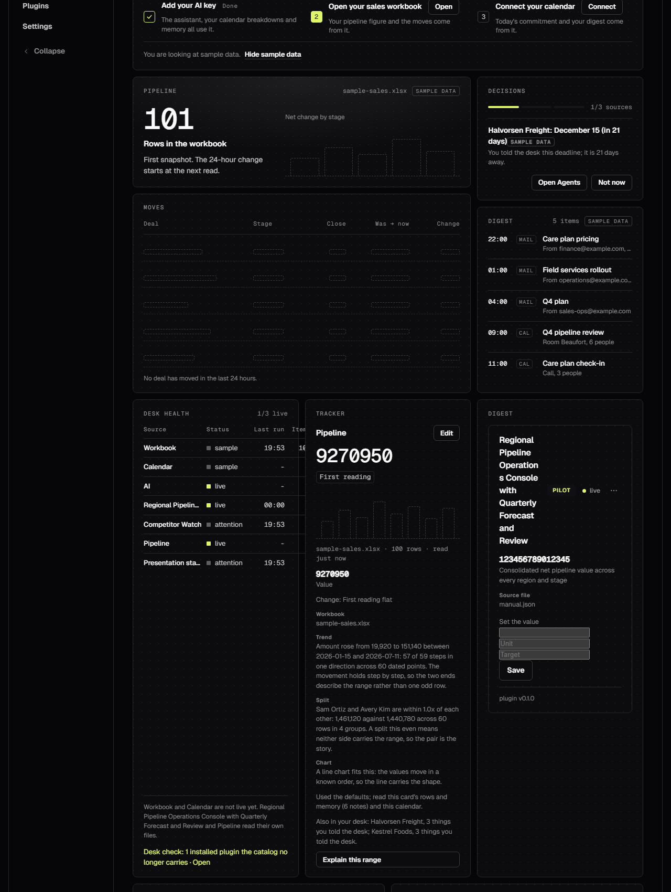
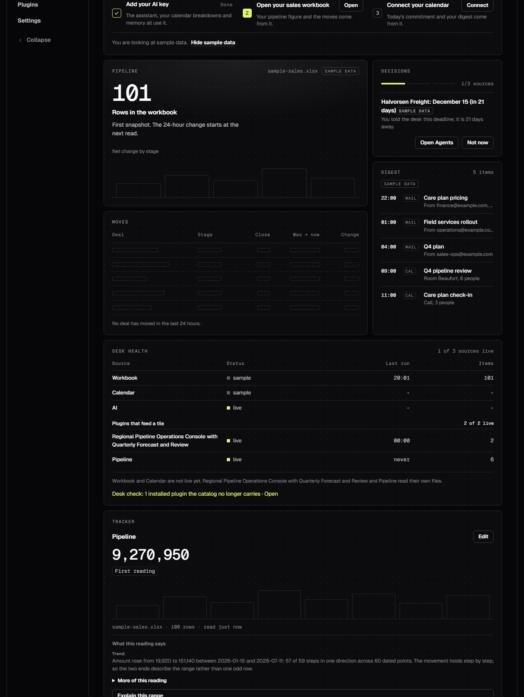
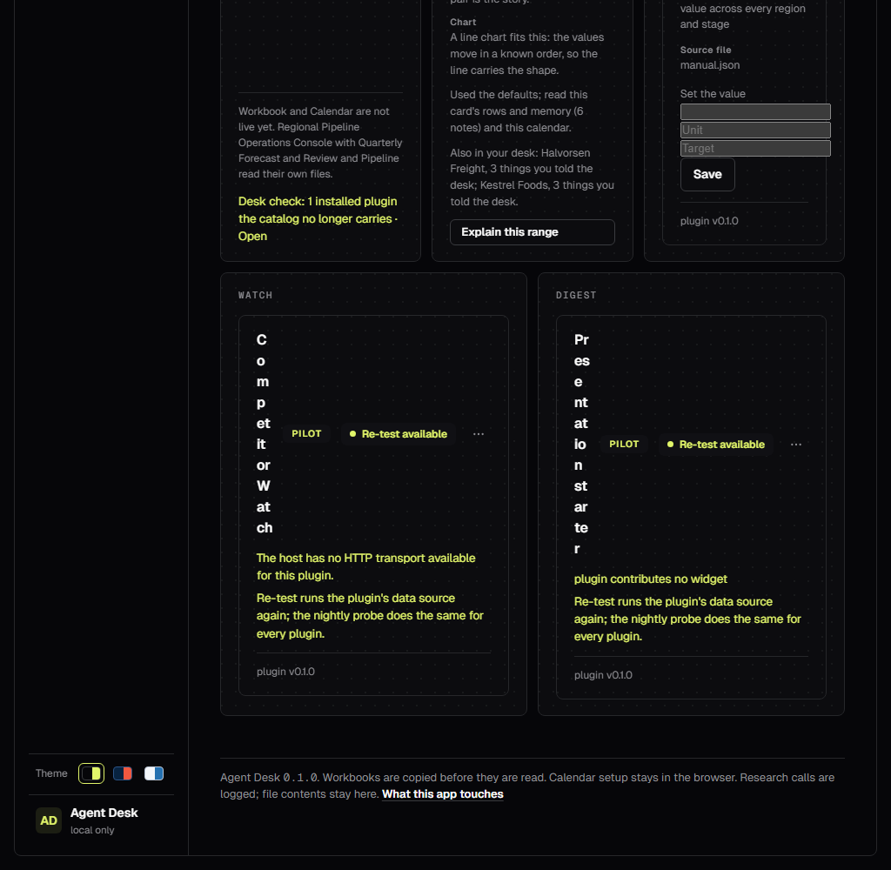
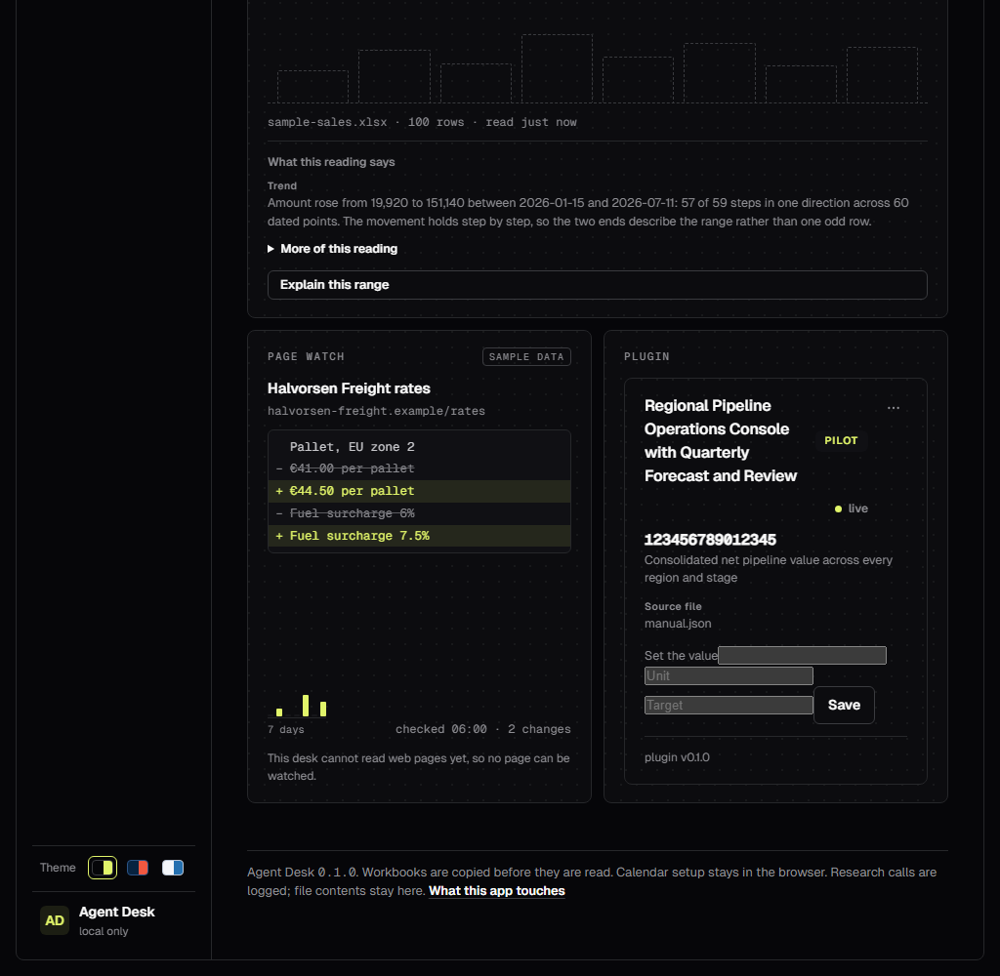
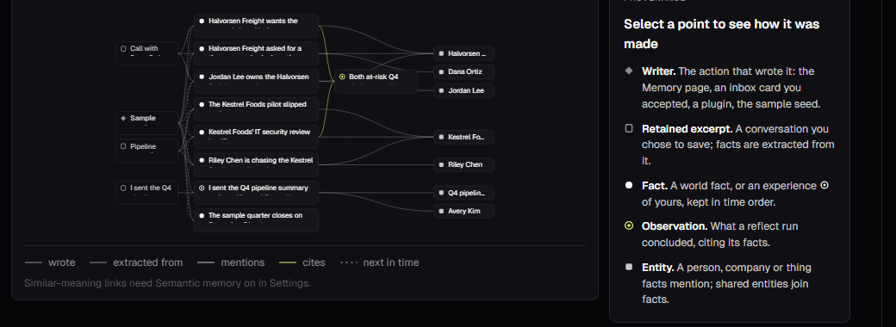
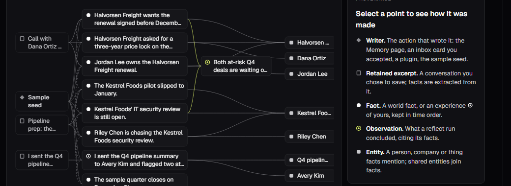
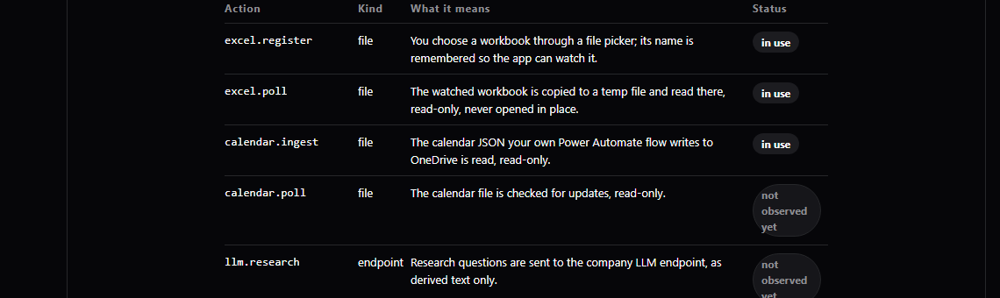
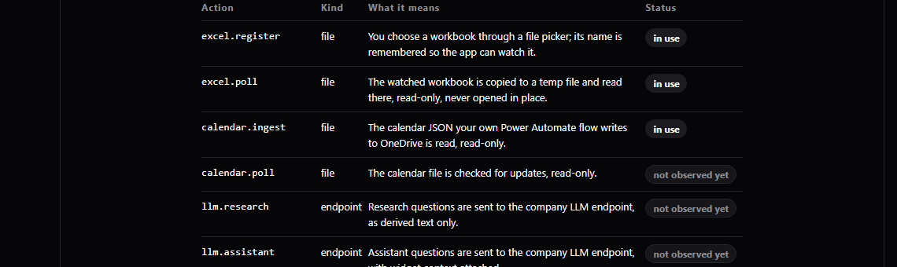

# Evidence: text that fits every screen (spec 026), 2026-11-24

All readings below were taken with one instrument, `tools/layout_audit.py`,
at the final tree `261d925`, on the same plan. BEFORE is main at
`f31582a`, the commit the wave started from. AFTER is `261d925` on
`merge/027-feedback`. This branch, `docs/026-027-evidence`, is cut from
`261d925` and changes documentation and screenshots only.

## The instrument and the plan

`tools/layout_audit.py` boots an isolated desk: its own temporary data
folder, an in-process mock model on `tools/mock_endpoint.py`, and a
file-backed stand-in keychain. It never reads the real data folder and
never touches the real keychain. It drives Chromium with Playwright and
records what the browser actually lays out. The selftest plants 16
expectations; the tool prints `SELFTEST PASS 16 detector expectations`
when they hold. Versions on this machine: Playwright 1.65.2, Chromium
1255, Python 3.14.5, Windows 10.0.26300 x64.

One-time browser install, if the Chromium build is not already present:

```bash
uv run --no-project --with playwright python -m playwright install chromium
```

Both runs used this command from Git Bash, from the repository root:

```bash
uv run --no-project --with playwright --with keyring --with cryptography \
  python tools/layout_audit.py \
  --conditions fresh,data,plugins,full,legacy-dashboard,long-values,busy \
  --fail-on none --jobs 2 --out <dir>
```

`--out` names the parent directory; the tool creates the timestamped run
folder under it. The plan is 7 conditions, 4 widths (800, 1024, 1280,
1920), 3 themes (`unkey`, `coforge`, `momentuum`) and 47 states. Every
state is measured with its real strings, then again with every string
tripled and joined by a space. That is 1,040 rows planned: 1,028
measured and 12 skipped.

The 12 skipped rows are all `overlay-widget-menu` in conditions `fresh`
and `data` (2 widths x 3 themes each), with the note `no widget overflow
trigger on this dashboard`. Nothing overflows there, so there is nothing
to open. The `plugins` and `full` conditions install the local fixture
plugin `tools/layout_fixtures/overflow-widget`, which gives the widget
overflow menu something to measure. The server now drops the cannot-run
network plugin's card, which used to cause that overflow.

| Run | Run folder | Tree |
| --- | --- | --- |
| BEFORE layout | `D:/20-projects/Personal Agents/.scratch/ui-text-overflow/v3-before/before-layout/20261124-194926` | main `f31582a` |
| AFTER layout | `D:/20-projects/Personal Agents/.worktrees/027-merge/build/final-layout/20261124-195742` | `261d925` |

Both full run folders are outside this branch: `build/` is ignored and
`.scratch` is outside the repository. The numbers and the selected
screenshots are committed; the run folders are not.

## The readings

The same plan ran before and after, so the rows compare one for one. The
two runs used the same instrument and the same conditions, widths, themes
and states.

| Reading | Under 11px | Other layout | Runtime | Total |
| --- | ---: | ---: | ---: | ---: |
| BEFORE, real strings, plain | 706 | 247 | 12 | 965 |
| BEFORE, long strings, plain | 42 | 51 | 0 | 93 |
| BEFORE, real strings, tripled | 90 | 456 | 0 | 546 |
| **BEFORE total** | **838** | **754** | **12** | **1,604** |
| AFTER, real strings, plain | 654 | 0 | 12 | 666 |
| AFTER, long strings, plain | 44 | 0 | 0 | 44 |
| AFTER, real strings, tripled | 86 | 40 | 0 | 126 |
| **AFTER total** | **784** | **40** | **12** | **836** |

"Under 11px" is the `tiny-type` detector at 10px and 10.5px. Type sizes
did not change in this wave; the class count followed the content the
final surfaces render. "Other layout" is every other detector.

Findings outside the 11px class: real and long strings 298 before (247
real plus 51 long, excluding the 12 runtime rows) and 0 after. Tripled
strings: 456 before and 40 after, all inside deliberate scrollers.

| Detector | BEFORE real | BEFORE long | BEFORE tripled | AFTER real | AFTER long | AFTER tripled |
| --- | ---: | ---: | ---: | ---: | ---: | ---: |
| `content-spill` | 99 | 25 | 117 | 0 | 0 | 0 |
| `squeezed-text` | 74 | 16 | 221 | 0 | 0 | 40 |
| `text-overlap` | 46 | 9 | 89 | 0 | 0 | 0 |
| `broken-word` | 20 | 0 | 0 | 0 | 0 | 0 |
| `control-collision` | 7 | 0 | 1 | 0 | 0 | 0 |
| `control-overlap` | 0 | 0 | 1 | 0 | 0 | 0 |
| `ellipsis-no-affordance` | 0 | 0 | 12 | 0 | 0 | 0 |
| `offscreen-content` | 1 | 1 | 11 | 0 | 0 | 0 |
| `text-clip` | 0 | 0 | 4 | 0 | 0 | 0 |
| `runtime` | 12 | 0 | 0 | 12 | 0 | 0 |
| **Total** | **259** | **51** | **456** | **12** | **0** | **40** |

The 40 tripled findings after are all `squeezed-text` in table cells
inside `div.table-scroll` on `/settings/activity` (20) and
`/what-this-touches` (20), where a tripled word wraps one word per line.
The table scrolls inside its own wrapper and the page never scrolls,
which is rule R6 of `docs/design-language.md`. They are deliberate, not
outstanding fit defects.

The 12 runtime rows after are the same browser console 403 on
`/marketplace/admin` when no administrator session exists. They were in
the before run too (8 in `fresh`, 2 in `data`, 2 in `plugins`) and this
wave did not change them.

The widget overflow menu overlay is its own small matrix: 24 rows
planned, 12 measured (`plugins` and `full`, widths 1024 and 1280, three
themes), 12 skipped in `fresh` and `data`. It produced 63 findings, all
`tiny-type` at 10px and 10.5px, and no finding outside the 11px class.

The counts above can be recomputed from `findings.json` and
`findings.long-values.json` in each run folder. `matrix.json` holds the
1,040 rows and `summary.md` prints the same totals.

An earlier after reading exists at
`D:/20-projects/Personal Agents/.worktrees/027-merge/build/after-layout/20261124-175748`
and its matching pending run
`D:/20-projects/Personal Agents/.worktrees/027-merge/build/after-pending/20261124-180650`,
taken with the previous version of the instrument (the layout run on a
972-row plan); it is superseded by the readings above and is not
tabulated.

## What was built

The wave wrote seven text-fit rules and four number rules. R1 to R7 are
in `docs/design-language.md` under "Layout and text fit"; N1 to N4 are
under "Numbers". The same declarations carry them in the SPA sheet and
the server sheet.

- R1 to R7: prose breaks rather than overflows; a text-holding flex or
  grid item can shrink; rows wrap before they squeeze text; chips drop to
  their own line; truncation is absent or reachable; a table that cannot
  fit scrolls in its own wrapper; the wrap contract holds in both style
  sheets.
- N1 to N4: compared numbers are grouped for display while the value a
  system reads keeps its digits; a figure prints in full and the layout
  makes room; a narrow bar may use compact notation with the exact value
  reachable; a timeline owns its own column contract.
- The style and surface fixes are in `frontend/src/index.css`, the
  dashboard cells and cards, the marketplace, the memory islands, and the
  server style sheet `STYLES` in `src/agentdesk/server/pages.py`.
- Long numbers: the hero figure prints in full and the stage chart wraps
  below it. `formatGrouped` in `frontend/src/dashboard/cells.tsx` is
  display only; bindings and chart points keep the exact digits.
- The calendar walkthrough answers 200 when its file is pinned empty:
  `default_calendar_hint` returns no path instead of `candidates[0]`
  (`f134f89`).
- Tests: `tests/test_ui_text_fit.py`,
  `frontend/src/test/text-fit-dashboard.test.ts`,
  `frontend/src/test/text-fit-marketplace.test.ts` and
  `frontend/src/test/text-fit-memory.test.ts`.

Key commits from the true history: `3d942ed` (the audit tool), `56161dc`
(the rules), `74588ce` (dashboard), `ad59df2` (marketplace), `14b01c4`
(memory), `aead705` (server sheet), `f134f89` (calendar walkthrough),
`7c549c7` (first bundle rebuild) and `261d925` (final bundle). The full
list is `git log --oneline f31582a..261d925`.

Two independent reviews of the first build, a fix round, a final
independent review with 11 findings, and a second fix round led to the
final bundle. The review contracts are pinned across
`tests/test_ui_text_fit.py`, `tests/test_ui_feedback_review.py` and the
`review-*.test.tsx` files.

## Screenshots

The images are crops of the named full-page PNGs in the run folders. Each
crop is an ffmpeg `crop=w:h:x:y` that changes no pixel; no other edit was
made. The four pairs show the largest visible differences and the finding
each pair closes.

**Pair 1. The dashboard at 1280 with plugins.**





`content-spill` on `article.cell.cell-health.span-4`, route `/`, 1280,
`unkey`, over by 44.45px, closes here, and so does `squeezed-text` on the
plugin title (79.86px wide, 9 lines): the health table now spans its own
row and the tracker figure prints 9,270,950 in full with the chart below.
Source: `full/1280x800/unkey/root__dashboard.png`, crop
`1280:1700:0:330`.

**Pair 2. The bottom of the dashboard at 1024 with plugins.**





`squeezed-text` on the Competitor Watch title, route `/`, 1024, `unkey`,
18.47px wide and 10 lines, closes because the final tree drops the
cannot-run card and the surviving plugin title wraps in two lines.
Sources: `full/1024x800/unkey/root__dashboard.png`, crop
`1024:1000:0:2805` before and `1024:1000:0:1836` after, because the page
reflowed between the runs.

**Pair 3. The memory graph at 1280 with plugins.**





`content-spill` on `div.mg-picture`, route `/memory/graph`, 1280,
`unkey`, 4px over on each side, closes: the picture stays in its canvas
and the node labels have room to wrap. Source:
`full/1280x800/unkey/memory_graph__memory-graph.png`, crop
`1040:380:240:420`.

**Pair 4. The touches table at 1280 with plugins.**





`squeezed-text` on `span.touch-badge`, route `/what-this-touches`, 1280,
`unkey`, 58.03px wide and 3 lines, closes: the "not observed yet" badge
is one line and the table keeps its columns. Source:
`full/1280x800/unkey/what-this-touches__what-this-touches.png`, crop
`1140:340:140:200`.

## Honest limits

- Text under 11px was out of scope and remains: 784 rows after (654 with
  real strings, 86 tripled, 44 long strings), at 10px and 10.5px.
- The 12 runtime rows on `/marketplace/admin` predate the wave: a
  browser console 403 when no administrator session exists. They are
  identical in the before and after runs.
- The instrument is not in the gate. Playwright is not a project
  dependency, the browser is not pinned in the project's dependencies,
  server pages use the operating system's fonts, and there is no
  committed findings baseline. `tools/ci_local.py` remains the
  deterministic 7/7 gate.
- The full run folders live outside this branch; the numbers and
  selected screenshots are committed.
- The 40 tripled `squeezed-text` findings are deliberate table scrolling
  under R6, not text that escaped its box.
- The audit runs headless Chromium on Windows only. Another operating
  system with different fonts can measure different subpixel widths.
